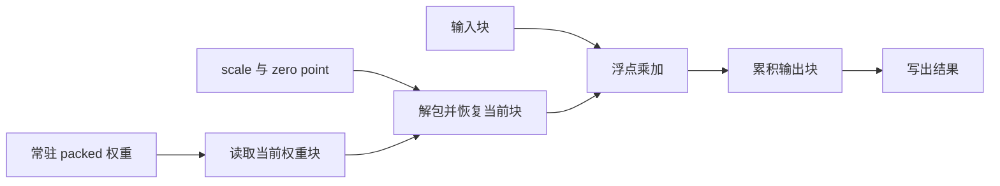

# W4A16：少读权重，怎样把省下来的带宽变成收益

W4A16 保留 16 bit 激活，用 4 bit 表示权重。它最直接的价值是缩小常驻权重和权重读取量；执行时仍要恢复权重数值，并完成浮点乘加。因此，算子设计要同时回答两个问题：怎样让压缩权重一直保持紧凑，怎样让解包与反量化的开销值得付出。

本项目使用 [GemLite](https://github.com/dropbox/gemlite) 的计算内核。下面从实际采用的布局和三条计算路径解释其设计。量化算法如何选择整数、scale 与 zero point，见[权重量化文档](../quantization/01-w4a16.md)。

## 1. 为什么单 token 和多 token 要区别对待

设输入为 $X\in\mathbb R^{M\times K}$，权重为 $W\in\mathbb R^{N\times K}$，输出为 $Y=XW^{\mathsf T}$。$M$ 是这次计算展开后的输入行数，$K$ 是输入通道数，$N$ 是输出通道数。

单请求 decode 通常只有一行输入。为产生这一行输出，仍要访问整层权重，权重很难在多行输入之间复用。以 $4096\times4096$ 的矩阵为例，FP16 权重占 32 MiB，打包的四位整数占 8 MiB，另加分组尺度。这时，少搬权重有很大的价值。

prefill 或批量计算有更多输入行。同一块权重可以服务多行输入，矩阵乘法能够进行更多数据复用，计算吞吐的重要性也随之上升。四位表示仍然节省存储，但解包、类型转换和尺度读取会成为额外工作。

只计算权重读取、忽略输入输出和辅助张量时，乘加运算量约为 $2MNK$，FP16 权重字节数为 $2NK$，四位权重为 $NK/2$。因此每读取一字节权重对应的运算量，分别约为 $M$ 和 $4M$。这说明压缩改变了数据搬运与计算的比例，也说明不同 $M$ 下的主要成本可能不同。

GemLite 为这些情况保留不同路径。项目的[分派入口](../../qslab/kernels/gemlite/ops.py)采用：

| 实际输入行数 | 路径 | 要解决的问题 |
|---|---|---|
| $M=1$ | GEMV RevSplit-K | 单行计算复用有限，控制尺度与零点读取、任务数量与归约开销 |
| $2\le M\le64$ | GEMM Split-K | 输出块不够多时，沿归约维度增加并行任务 |
| $M>64$ | GEMM | 利用多行输入复用权重块，减少跨任务归约 |

这些分界是当前实现的选择，不是所有矩阵和 GPU 的最优分界。一个请求验证多个候选，也会增加 $M$；512 token 的 prompt 若按 64 token 分块，单次 Linear 看到的则是 $M=64$。因此，要按这次实际计算的形状理解分派，而不能只看请求数或“prefill / decode”名称。

## 2. 为什么紧凑权重还需要专门的布局

离线权重包保存的是逻辑整数。执行后端需要把它变成适合 GPU 访问的存储形式，并让整数、尺度和零点能够一起按块读取。

### 2.1 八个四位整数装进一个字

每个 32 bit 字保存同一输出通道上、沿 $K$ 方向连续的八个四位码。读取通道 $k$ 时，可以由 $\lfloor k/8\rfloor$ 找到字，再由 $4(k\bmod8)$ 找到其中的四位。

对称量化的逻辑整数是 $q\in[-8,7]$，存储码为 $u=q+8$；还原时减去 8。非对称量化直接保存 $u\in[0,15]$，使用对应分组的 zero point。两者统一为：

$$
\widehat W_{n,k}
=\left(u_{n,k}-z_{\lfloor k/G\rfloor,n}\right)
s_{\lfloor k/G\rfloor,n}.
$$

这里的 $G$ 是权重量化分组大小。对称整数加 8 只改变存储编码，不改变量化结果。

### 2.2 为什么打包后转置

原始权重按 `[N,K]` 理解。沿输入通道打包后先得到 `[N,K/8]`，后端再将它转置并整理成连续的 `[K/8,N]`；scale 和非对称 zero point 则使用 `[K/G,N]`。

这使同一个 packed-K 位置上，相邻输出通道的权重字在内存中相邻。计算一个输出通道块时，程序可以成块读取这些字；处理同一量化组时，对应的一组尺度也沿 $N$ 连续。权重及其尺度、零点遵循同一个访问方向，减少了计算时重新整理布局的需要。

这种布局同时服务向量和矩阵路径，模型切换 decode、verify、prefill 时使用同一份常驻权重。[打包实现](../../qslab/kernels/gemlite/bitpack.py)与[加载适配](../../qslab/runtime/backends/gemlite.py)负责建立这份布局。

打包放在模型加载阶段，forward 只消费已经准备好的 buffer。离线包继续保存算法层面的逻辑整数，因此算法产物与某个后端的执行布局可以各自演进。

## 3. 为什么把反量化放进计算内核

一个直接的实现是先恢复整张 FP16 权重，再调用普通矩阵乘法。这样容易理解，但每次调用都会增加完整浮点权重的生成、写出和读取；若一直保留这张浮点矩阵，又会失去紧凑常驻存储的优势。

GemLite 将反量化放进计算循环。程序只恢复当前需要的权重块，随即参与乘法，而不额外写出一张完整浮点权重。

这仍然是浮点计算：四位整数经移位、掩码、减零点和乘尺度后，转成相应浮点类型参与乘法。W4A16 描述的是权重表示与激活精度，不意味着这条路径直接执行“四位权重乘十六位激活”的整数指令。

代价也随之明确：权重读得更少，但每个权重块多了解包和恢复工作。块内复用越充分，这部分工作越容易摊薄；若恢复后的块、累积结果和流水线占用过多片上资源，也会压低并行度。减少全局显存流量与控制局部计算成本，需要同时考虑。

对应的数值恢复在 [`dequantize`](../../qslab/kernels/gemlite/triton_kernels/utils.py)，它由各条计算路径直接调用。

## 4. 多行输入：先让一个程序算好一块输出

普通 GEMM 把输出切成多个 $B_M\times B_N$ 的块，分别覆盖 $B_M$ 行输入和 $B_N$ 个输出通道。每个 Triton 程序负责一块输出，沿 $K$ 方向循环，每轮处理 $B_K$ 个输入通道。

在一轮循环中，$B_K\times B_N$ 的权重块被恢复后，服务 $B_M$ 行输入；$B_M\times B_K$ 的输入块也同时服务 $B_N$ 个输出通道。增加这种块内复用，是矩阵路径的重要收益。Triton 程序内部的线程与 warp 分工由编译器组织；程序数量和每个程序内部的工作量，是两个不同层面的并行。

这与 [Triton 矩阵乘法教程](https://triton-lang.org/main/getting-started/tutorials/03-matrix-multiplication.html)中的分块计算相通。GemLite 在相应位置增加了 packed 权重访问和块内反量化，使用 `tl.dot` 完成矩阵乘加。

当前后端为 GEMM 配置 FP32 块内累积。一个程序遍历自己负责的完整 $K$ 后，再转换并写出最终输出块，程序之间不需要为这个块合并部分和。

### 块大一些有什么代价

更大的 $B_M$ 或 $B_N$ 可能提高复用，也会放大累积矩阵；更大的 $B_K$ 和更多流水线 stage 可能提高加载与计算的重叠，也会增加片上资源需求。输入行数不够填满块时，还会有被 mask 掉的计算位置。

量化组又给 $B_K$ 增加了一层约束：权重组内共享尺度，块的切分需要与组边界配合，否则一个块内就不能用尺度和零点的广播处理。当前候选配置会结合分组、打包粒度和资源估计进行筛选。

因此，调优选择的是“复用、任务数量、尾部浪费和片上占用”之间的组合，而不只是挑一个最大的块。具体循环与配置筛选见 [GEMM 实现](../../qslab/kernels/gemlite/triton_kernels/gemm_A16fWnO16f_int32packing.py)。

## 5. 少量输入行：用 Split-K 增加可运行的任务

当 $M$ 较小时，输出沿 $M$ 切出的块很少。如果每个输出块都由一个程序独自遍历完整 $K$，可能没有足够多任务让 GPU 并行工作。

Split-K 将同一个输出块的 $K$ 方向工作分给多个程序。每个程序只计算部分乘积和，最后把这些部分和加到同一个输出块：

$$
Y_{m,n}=\sum_{s=0}^{S-1}
\left(\sum_{k\in\mathcal K_s}X_{m,k}\widehat W_{n,k}\right).
$$

本实现按交错的 $K$ 块分工：一个 split 从自己的起始块出发，每轮前进 $S B_K$。所有 split 的块合起来覆盖完整归约维度。这样并没有减少总乘法量，而是把一次较长的任务拆成更多能够并行运行的任务。

各程序先在内部累积，再通过原子加法合并结果。输出在这种计算前需要清零。FP16 主路径的合并目标是 FP16 输出 buffer，所以“块内 FP32 累积”并不意味着跨 split 合并也始终保持 FP32。

这种分工增加了原子归约、重复访问和启动开销。$M$ 增大后，输出块本身已经提供更多并行，继续拆 $K$ 的价值可能下降。因此 Split-K 的数量需要随形状选择，候选中也允许 $S=1$。

源码入口是 [GEMM Split-K](../../qslab/kernels/gemlite/triton_kernels/gemm_splitK_A16fWnO16f_int32packing.py)。阅读时主要看程序的二维 grid、$K$ 指针的步进与输出原子加法，就能对应上述分工。

## 6. 单行输入：RevSplit-K 怎样减少过细的分工

$M=1$ 时，强行把输入当作至少十几行的矩阵块，会有许多没有实际输入的行。GemLite 的单行路径采用向量乘积和归约，避免依赖这种矩阵块填充。

但向量路径也有另一端的问题：若每个程序只处理很短的一段 $K$，就会产生许多小任务。每段都要读自己的尺度与零点，还要原子加回输出，管理这些部分和的成本可能过高。

[GemLite 对 RevSplit-K 的说明](https://github.com/dropbox/gemlite#deep-dive)强调增加每个程序的工作量，以减少尺度与零点加载和任务数量。项目采用的实现具体做了两段相邻 $K$ 块：

1. 一个程序负责一组输出通道和两个相邻的 $B_K$ 输入片段。
2. 先读取这一对片段共用的 scale 与 zero point。
3. 分别读取两段输入和 packed 权重，恢复数值并计算向量乘积和。
4. 在程序内部合并这两段，再原子加回输出。

配置要求这两段仍位于同一个量化组内，即 $2B_K\le G$，并满足相应对齐条件。这样第二段可以继续使用已读取的尺度与零点。相比把两段各交给一个程序，任务数和全局部分和合并次数都会减少。

它仍然沿 $K$ 保持许多并行任务，只是避免把每份工作切得过细。这里的取舍与 Split-K 增加任务数量正好从两个方向处理同一件事：任务既要足够多，也要有足够的实际工作。

完整分工见 [RevSplit-K GEMV](../../qslab/kernels/gemlite/triton_kernels/gemv_revsplitK_A16fWnO16f_int32packing.py)。这条路径有自己的乘法、向量归约和原子累加过程，精度需要按它的实际实现判断，不能套用 GEMM 的累积设置。

## 7. 项目接入时保留哪些边界

同一套计算内核可以消费 RTN、RTN-Clip、AWQ 和 AWQ-Affine 的逻辑产物，因为它面对的是整数、分组尺度、零点和输入，而不是离线搜索过程。

AWQ 类算法还需要对输入做逐通道缩放。当前 [`GemLiteLinear.forward`](../../qslab/runtime/backends/gemlite.py)在调用内核前显式完成输入除法。这使算法变换与上游计算内核能够分开核对，同时也留下了一次独立运算及其张量开销；这部分需要计入完整调用成本。

packed 权重、scale、zero point 和 input scale 注册为模块 buffer，随模块管理设备和生命周期。模型加载阶段的打包临时空间、forward 中的输入整理，以及稳态常驻权重，是不同的开销。

后端入口还检查激活 dtype、分组对齐和输出通道对齐；当前真实量化加载不接收带 bias 的目标投影。约束与来源说明见[后端实现](../../qslab/runtime/backends/gemlite.py)及[算子源码说明](../../qslab/kernels/gemlite/README.md)。

## 8. 怎样用结果判断这些设计是否划算

上述设计解释了可能节省的成本，以及为此增加的成本。具体形状的主要瓶颈仍要由测量判断。

[W4A16 单算子结果](../../benchmarks/kernels/w4a16/RESULTS.md)中，单行输入通常有明显收益，较多输入行则有快有慢。这与“权重流量减少，但增加恢复与归约工作”的设计取舍相符，不能从四位存储直接推导所有形状都更快。

进一步阅读时，GPU Graph 计时用于观察主要设备执行成本，同步主机计时用于观察一次完整调用；[引擎测量](../../benchmarks/runtime/engine/README.md)再加入模型其他层、调度、缓存和采样。数值误差与性能的判断方法见[验证文档](03-validation.md)。
