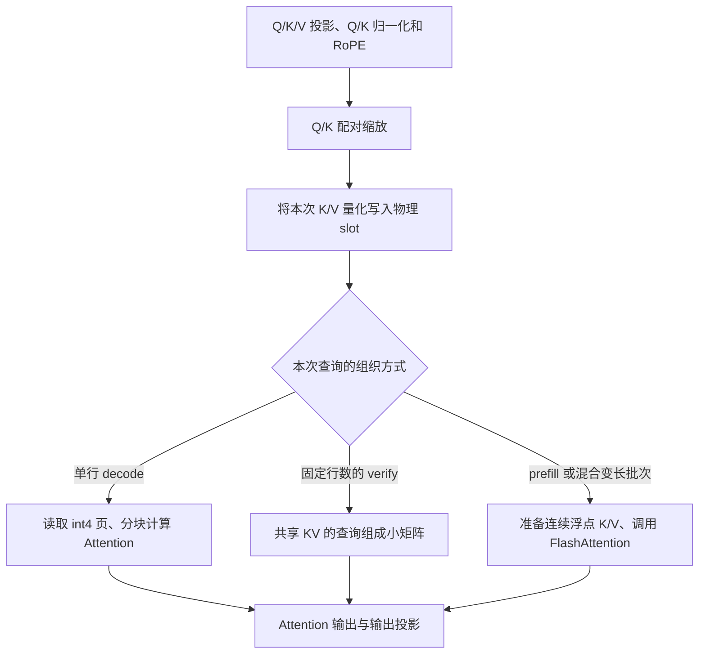

# KV4 Attention：围绕压缩缓存组织整次计算

Attention 的输出来自 $\operatorname{softmax}(QK^{\mathsf T}/\sqrt D)V$。缓存变成四位表示后，这个计算目标保持不变，但 Key、Value 的存储位置、读取方式、数值恢复和并行分工都需要配合起来。

本项目为 KV4 实现了缓存写入、分页 decode、多位置 verify 和前缀恢复；prefill 组合使用官方 FlashAttention。理解整个方案，需要沿着“新 token 怎样进入缓存、查询怎样读到正确历史、怎样在少搬数据的同时完成 Attention”这条线阅读。

以下以项目 FP16 在线模型为背景。K 的静态逐通道量化、V 的动态分组量化和平滑参数选择，见[量化文档](../quantization/02-kv4.md)。本文重点解释这些表示怎样进入实际计算。

## 1. 先看一层 Attention 的完整数据流

[模型层](../../qslab/runtime/model/qwen3.py)先分别计算 Q/K/V 投影，对 Q/K 做归一化和 RoPE，再进入 [`PagedAttention`](../../qslab/runtime/model/attention.py)。Attention 输出最后经过输出投影。

PagedAttention 内部先做配对缩放 $Q'=Q\Lambda$、$K'=K\Lambda^{-1}$，随后量化并保存本次 K/V。Q 保持浮点，之后按工作量选择计算路径：

这种分工把两类问题分开：运行时准备查询长度、页表和写入位置，Attention 根据这些信息完成数值计算。页的分配、请求结束和投机接受由运行时负责；内核面对的是一次计算所需的明确地址与有效范围。

选择多条路径，首先是因为可复用的数据不同。单行 decode 只有一个新位置，却要读取较长历史；verify 同时拥有多个相邻位置；prefill 则有更多查询行，适合成熟的矩阵 Attention 实现。下文用 $M$ 表示每请求本次的查询行数：普通 decode 为 1，verify 则包含最后一个已提交 token 与后续候选。缓存格式可以一致，计算组织不必完全一致。

## 2. 先决定数据怎样保存，才能决定怎样读取

### 2.1 缓存布局服务逐 token、逐 KV head 的访问

设总物理 slot 数为 $S$，Q head 数为 $H_q$，KV head 数为 $H_{kv}$，head 维度为 $D$。每层保存：

| 数据 | 形状 | 为什么这样组织 |
|---|---|---|
| K 四位整数 | `[S,H_kv,D/8]`，UINT32 | 同一 slot、head 下的八个连续通道合为一个字 |
| K 静态尺度 | `[H_kv,D]`，FP16 | 所有 token 共享逐通道校准尺度，无需随历史增长重复保存 |
| V 四位整数 | `[S,H_kv,D/8]`，UINT32 | 与 K 使用相同通道打包方式，读取地址计算可以对应 |
| V 动态尺度 | `[S,H_kv,D/G_v]`，FP16 | 每个 token、head 的每组通道有自己的范围 |

例如 $D=128$、$G_v=64$ 时，一个 token、一个 KV head 的 K/V 整数合计 128 字节，再加 4 字节 V scale；FP16 K/V 则需要 512 字节。静态 K scale 是另外一份共享表。这个例子说明四位缓存为什么仍有尺度成本，也说明常驻缓存的压缩比会略小于四倍。

K/V 都以 $q+8$ 保存有符号四位整数。八个相邻通道装进一个字，便于按通道块加载后，用移位和掩码恢复。量化组决定哪些数共用尺度，打包字决定哪些码一起存储；默认一组 V 包含多个打包字，二者各自解决不同问题。

### 2.2 分页让逻辑历史与物理位置分开

不同请求长度不同，还会发生共享前缀、释放与重新分配。若每个请求都预留一整块最大上下文空间，很多位置会空着。分页用统一的页池保存内容，每个请求只保留自己的页表。

物理页大小为 $P$，请求的逻辑位置为 $t$ 时：

$$
\operatorname{slot}(t)
=\operatorname{table}[\lfloor t/P\rfloor]P+(t\bmod P).
$$

例如 $P=256$、页表为 `[7,2]`，逻辑位置 260 位于第二页的第 4 个 slot，实际地址就是 $2\times256+4$。逻辑历史保持顺序，物理页可以分散。

写入侧通过 `slot_mapping` 直接拿到本次 token 的物理位置；读取侧沿逻辑历史前进，使用页表寻找对应物理页。这样内核无需知道这些页是怎样分配出来的。

## 3. 为什么先独立完成写入，再开始 Attention

decode 的上下文长度包含正在处理的这个 token。它的 Key、Value 必须先写进缓存，查询才能把当前位置也纳入 Attention。若先读取，当前位置可能还是旧内容。

[写入内核](../../qslab/kernels/kv4/store.py)以输入 token 分配程序，一个程序处理该 token 的多个 KV head 和通道：读取 K/V、计算 V 的组尺度、编码、打包并写到指定 slot。静态 K scale 直接读取，不在每步重新估计。

这个粒度让每份新 K/V 有明确的写入责任。后续计算可能按多个 Q head、多个查询块和多个历史分片展开；若让每个读取程序都重新量化并写入共享 K/V，就会重复计算尺度和重复写缓存，还需要处理程序之间的写读顺序。

独立写入让这些读取程序共同消费已经准备好的缓存。当前执行流先提交写入，再提交 Attention；CUDA Graph 中也保留对应执行依赖。实现集中处理一次写入，同时供几种 Attention 路径使用。

写入侧还有两个与上层组织有关的约定：

- `slot=-1` 表示填充行，跳过写入。固定形状的 Graph 因此可以容纳无效行，同时保护真实缓存内容。
- 输入按 token stride 读取。即使 K/V 来自较大张量中的非连续切片，也可以直接写缓存，减少为整理输入而复制整份张量的需要。

## 4. 为什么计算块不直接等于物理页

页大小影响分配粒度、页表长度和缓存管理；一次计算多少个 Key，则影响内核的局部资源占用。两种粒度需要分别选择。

当前实现将计算 tile 限制为最多 64 个 token，物理页仍可为 256 个 slot。一页可以由多轮 tile 计算覆盖，地址公式负责把每个逻辑位置映射到页内。

这样选择的直接原因是：四位数据读进来以后，要恢复为浮点值，局部工作集会明显放大。以 $D=128$ 为例，一个 64 行 K 块恢复成 FP32 后有 32 KiB 的逻辑元素；若按 256 行恢复，就有 128 KiB。此外还要容纳 V、分数和输出累积。实际寄存器与共享内存如何分配由编译器决定，但临时数据的规模已经相差四倍。

较小 tile 控制局部占用，有利于保持更多程序并行；代价是循环次数、页表访问和 softmax 状态更新增多。较大 tile 可以减少这些轮次，却可能因资源压力得不偿失。这也是缓存节省与计算加速需要分别测量的原因。

计算 tile 与物理页的参数在 [Attention 分派函数](../../qslab/kernels/kv4/paged_attention.py)中分别传给内核。

## 5. 单行 decode：边读缓存，边完成 Attention

### 5.1 一次程序负责什么

单行路径按查询行、Q head 和历史分片分配程序。GQA 中多个 Q head 共享一个 KV head，通过 $h_{kv}=\lfloor h_q/(H_q/H_{kv})\rfloor$ 找到对应缓存。

一个程序保留自己的 Q 向量，沿历史逐 tile 前进。每轮先查页表，读取 packed K 和相应尺度，恢复数值并与 Q 点积；再读取 packed V 和组尺度，将当前块的贡献加入输出。

恢复只发生在当前块。完整浮点 K/V 和完整历史分数不需要另行写出。主要临时结果留在一次计算内部，最终才写出输出或供分片合并的部分结果。

### 5.2 为什么 softmax 也可以分块

softmax 需要全局归一化，不能把每个 tile 单独归一化后直接相加。解决方法是保留三个量：已见分数的最大值 $m$、以该最大值为基准的指数和 $l$，以及尚未归一化的 V 加权和 $a$。起始状态为 $m=-\infty$、$l=0$、$a=0$。

对新一块分数 $z$，更新为：

$$
\begin{aligned}
m'&=\max(m,\max_i z_i),\\
\alpha&=\exp(m-m'),\\
l'&=\alpha l+\sum_i\exp(z_i-m'),\\
a'&=\alpha a+\sum_i\exp(z_i-m')\widehat v_i.
\end{aligned}
$$

最后才计算 $O=a/l$。当最大值变大时，用 $\alpha$ 将旧的分母与加权和换到新的指数基准，因此前面的块仍然可以正确参与最后的归一化。

这是与 [FlashAttention](https://arxiv.org/abs/2205.14135)相通的分块 Attention 思路：减少大中间矩阵的显存往返，同时保留完整的 Attention 计算。四位缓存增加的是读取时的数值恢复；它与这种流式归一化可以组合。

实现见 [`kv4_paged_decode_kernel`](../../qslab/kernels/kv4/paged_attention.py)。Q、恢复后的 K/V、softmax 状态和加权累积在这条路径中使用 FP32 运算，最终输出回到 FP16。

## 6. 历史很长、查询很少时，怎样增加并行度

如果每个 Q head 都只由一个程序顺序遍历长历史，可运行的程序数量会受查询数和 head 数限制。split-KV 将历史切成几份，各自并行计算，然后合并结果。

W4 Split-K 的部分乘积可以直接相加；Attention 还包含 softmax，分片必须保留归一化所需的信息。每份输出的仍是 $(m_s,l_s,a_s)$，不能只输出一个已经归一化的局部 Attention 结果。各份包含的概率总质量不同，直接平均会丢失这些权重。正确合并为：

$$
m=\max_s m_s,\qquad
O=\frac{\sum_s\exp(m_s-m)a_s}
{\sum_s\exp(m_s-m)l_s}.
$$

当前实现先将这些状态写入 FP32 临时空间，再由 [`merge_kv4_splits`](../../qslab/kernels/kv4/paged_attention.py)完成稳定归约。每个查询头、每份历史需要 $D+2$ 个 FP32 值，分别对应向量 $a_s$ 和标量 $m_s,l_s$。

因此，split-KV 用临时存储、一次额外内核和结果归约，换取更多历史读取任务。分片数最多为 8；查询本身足够多时，继续增加分片可能主要增加开销。

### 为什么启发式使用容量

分片选择使用页表形状所表示的容量，并结合已有程序数量估计。容量与张量形状在启动时已经可知，选择过程不需要把每个请求的实际长度从 GPU 取回；固定执行形状也较容易供 Graph 使用。

这里同时考虑两种情况：外层查询任务少时，通过更多历史分片补充并行；历史容量大时，通过分片缩短每份遍历的长度。已有查询任务多、历史又短时，分片的必要性就较低。单行路径按查询行和 Q head 估计外层并行，多查询路径则按请求、KV head 和查询块估计。

代价是容量可能大于实际历史。某些分片因而没有内容，仍会产生调度或合并开销。实际遍历范围在内核中按有效长度限制，空分片以零概率质量参加合并。实现对全屏蔽块的指数基准做了保护，避免由负无穷相减产生 NaN。

这些规则是控制任务数量的启发式，而非对具体 GPU 延迟的精确预测。分派源码中的常数也不应被解释成硬件 SM 数量。

## 7. 多位置 verify：把共享 KV 的查询放在一起算

### 7.1 复用机会来自两个方向

verify 一次计算多个相邻位置，每个位置又有多个 Q head 共享同一个 KV head。如果为每个位置、每个 Q head 都独立运行向量路径，同一份 K/V 会在不同程序中反复访问和解包。GPU 缓存可能减少部分显存读取，但程序内的恢复工作仍然重复。

[多查询内核](../../qslab/kernels/kv4/grouped_attention.py)把同一个 KV head 对应的“查询位置 × Q head”合成一串行，再每 16 行组成一个小查询块。

例如一个 KV head 对应 4 个 Q head，验证 16 个位置，就有 64 行查询，分成 4 个查询块。一个 16 行块包含 4 个位置、每个位置的 4 个 Q head。这个块共同使用同一份恢复后的 K/V tile：

$$
Q_{\text{block}}[16,D]\;K_{\text{tile}}^{\mathsf T}[D,B_N]
\longrightarrow \text{scores}[16,B_N].
$$

随后，概率块与 V tile 再做一次矩阵乘法。K/V tile 供这些查询行共同使用，每行的 softmax 最大值、分母和输出独立维护。这样既在一个程序内复用了解包结果，也形成了适合 Tensor Core 的小矩阵。复用范围是当前查询块；不同查询块、不同历史分片仍会分别访问缓存。

### 7.2 为什么单行 decode 仍保留向量路径

查询数少时，一个 16 行矩阵块可能只有少数有效行，剩余位置需要 mask。矩阵操作的组织成本与填充工作未必能被复用收益抵消。当前实现因此在 `verify_m>1` 时选择多查询路径，普通单行 decode 使用前面的向量路径。

这反映的是“小矩阵是否有足够有效工作”的取舍，不能仅凭使用 Tensor Core 就判断一定更快。

### 7.3 复用同时改变了数值过程

多查询路径把恢复后的 K/V 转成 FP16 参加矩阵乘法，分数、softmax 状态和输出累积保留 FP32；在概率乘 V 时，概率块也会转成 FP16 作为矩阵输入。

它与单行路径访问相同的整数缓存，但局部舍入和归约顺序不同，因此应比较允许误差下的结果，而非要求两条路径逐 bit 相同。压缩数据的复用、矩阵计算的吞吐和数值精度，是同一个设计中的三项取舍。

## 8. 多个位置一起算，怎样保证不会看到未来

设验证前已提交 token 数为 $L$，最后一个已提交 token 的位置为 $L-1$。验证输入从它开始，后面接候选。第 $r$ 行处理位置 $L-1+r$，因此只允许读取：

$$
0\le t<L+r.
$$

例如 $L=100$、验证 4 行时，各行可读 Key 数分别为 100、101、102、103。虽然四行的新 K/V 都已经写入缓存，第 0 行仍只能读取位置 0 到 99。写入完成表示数据存在，因果 mask 决定当前查询有权读取哪些数据。

多查询内核根据每行对应的位置分别构造有效范围，GQA 的几条 Q head 行使用相同位置边界。每个请求又有自己的页表与长度，因此同一批次内不会互相读取其他请求的历史。

地址安全还需要另外处理：页表的填充项可以为 -1。读取侧先把这类物理页号限制到安全地址，再将对应分数屏蔽为负无穷，使其概率权重为零。写入侧的 `slot=-1` 跳过则保护缓存内容。固定形状中没有实际用途的查询行，其输出由运行时筛除；并不依赖这些行恰好算出某个固定数值。

相关输入约定见 [Context](../../qslab/runtime/model/context.py) 和 [`prepare_verify` / `verify_logits`](../../qslab/runtime/execute/model_runner.py)。

## 9. prefill 为什么组合使用 FlashAttention

prefill 拥有较多查询行，官方 FlashAttention 已经提供了成熟的变长（varlen）、因果 Attention 计算。当前方案使用它处理这些查询，将自研计算集中在压缩缓存写入、分页小查询和必要的前缀恢复上。

### 9.1 首次 prefill：新 K/V 已经是浮点

没有已有前缀时，本次计算已经得到完整的浮点 Q/K/V。当前路径先把 K/V 量化保存，供以后读取；当前块的 Attention 则直接使用浮点输入。

因此，本次 prefill 输出没有经历“先把整段 K/V 量化，再从缓存恢复”的过程。缓存格式决定了之后的读取精度与常驻占用，当前输出还取决于它实际使用的计算路径。

### 9.2 分块 prefill：历史只存在于压缩缓存

已有前缀时，新查询需要同时看到历史前缀和本次新 K/V。官方接口无法直接解释本项目的四位 packed 数据、静态 K scale 和动态 V scale，因此先将需要的历史 slot 恢复为连续 FP16，再按请求拼接新块。

这里有两个不同的顺序：输入 Q 按“本次查询行”排列，K/V 按“每个请求的历史加新块”排列。`cu_seqlens_q` 与 `cu_seqlens_k` 分别描述它们的请求边界。前缀恢复和拼接必须遵守这个顺序，长度正确而内容顺序错误，仍然会计算出错误的 Attention。

[`materialize_kv`](../../qslab/kernels/kv4/layout.py)把选定 slot 的读取、解包和乘尺度放进一次内核，直接写到最终的浮点恢复张量，减少中间 gather 与转换张量。但恢复后的 FP16 前缀与随后拼接的空间仍然存在，也会增加显存流量。

### 9.3 混合批次怎样放进同一条路径

有 prefill 的混合批次，以及需要变长验证的情况，由运行时统一准备为 varlen Attention。对批次中的 prefill 请求，K/V 是恢复的历史前缀加本次新浮点行；对同批 decode / verify 请求，所需 K/V 从缓存恢复，包含刚刚写入的行。

因此，多位置验证并不总是调用前面的 grouped 内核。固定 M 行的纯验证使用 grouped 路径，混合变长计算则复用 FlashAttention。[FlashAttention 的因果约定](https://github.com/Dao-AILab/flash-attention)将查询末尾与 Key 末尾对齐。若查询长为 $T_q$、Key 长为 $T_k$，第 $r$ 行可读到的位置为 $T_k-T_q+r$（含该位置）；前缀加新块时，这正好对应当前查询所在的位置。

### 9.4 为什么前缀地址计划只准备一次

不同模型层使用相同的逻辑 token 位置与页表组织，但保存各自的 K/V 内容。运行时可以在一次 step 中准备好 slot 列表和拼接计划，所有层沿用这份地址计划，在各层自己的缓存中读取。

若每层都重新从设备长度和页表提取标量来组织前缀，会重复付出同步与计划构造成本。当前 [`prepare_prefill`](../../qslab/runtime/execute/model_runner.py)统一准备 `prefix_slots`、`prefix_plan`，[`_materialize_prefix`](../../qslab/runtime/model/attention.py)按计划完成每层的数据恢复与拼接。

这条组合路径的取舍很明确：使用成熟的多查询计算，承担浮点前缀恢复、拼接与临时空间开销。它节省的常驻 KV，与一次 prefill 的峰值显存，需要分别看待。

## 10. 怎样评价整个方案

几个设计分别解决不同问题，也有各自的成本：

| 设计 | 主要收益 | 同时付出的成本 |
|---|---|---|
| 四位常驻 K/V | 缩小缓存容量和整数数据读取量 | 尺度存储、解包和数值恢复 |
| 分页 | 支持不同长度、释放和前缀复用 | 页表读取与地址计算 |
| 小计算 tile | 控制局部数据规模 | 更多循环与状态更新 |
| split-KV | 为少量查询增加历史读取并行度 | FP32 部分结果、额外归约与空分片 |
| 按 GQA 和位置组织查询块 | 复用 K/V 恢复，形成矩阵计算 | 填充、FP16 矩阵输入及不同归约顺序 |
| prefill 恢复前缀后使用 FlashAttention | 复用成熟的多查询计算 | FP16 前缀与拼接的流量和空间 |

[单层测量](../../benchmarks/kernels/kv4/RESULTS.md)同时列出真实 Attention 层耗时与分项耗时。表中有部分 verify 形状受益，也有 KV4 慢于 FP16 的形状，说明常驻压缩与执行速度需要分别评估。某个形状究竟受哪项成本主导，要结合 [Nsight](../../benchmarks/runtime/profile/README.md)观察。

进一步看[完整请求](../../benchmarks/runtime/engine/README.md)、[模型质量](../../benchmarks/runtime/kv4/README.md)与[整模显存](../../benchmarks/runtime/memory/README.md)，才能知道这套 Attention 设计对项目整体的实际影响。对应的数值与边界验证见[下一篇](03-validation.md)。
