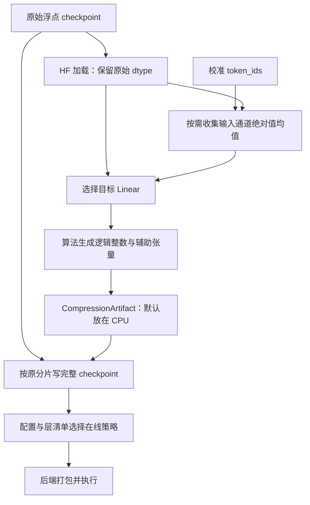

# 量化包设计、字段与使用

离线工具将原始浮点模型转换成可独立加载的完整 checkpoint。生成后，在线加载模型参数和 tokenizer 只依赖产出目录；W4 的量化算法由包内声明，具体 packed 布局由执行后端在加载时生成。启用 KV4 时另行传入校准文件。

本文命令在远程 Linux/CUDA 仓库根目录执行，Python 依赖使用项目专属 `.conda`，不向全局环境安装。

## 1. 为什么采用完整 checkpoint

| 设计 | 目的与代价 |
|---|---|
| 保存全部权重、配置和 tokenizer | 搬运产出目录即可加载，避免依赖原始模型路径 |
| 沿用原权重名和分片归属 | 容易定位量化前后的同一参数，辅助张量也可按原分片读取 |
| 逻辑 W4 整数以 INT8 容器落盘 | 协议简单，不绑定具体 kernel；磁盘占用高于紧凑 int4 |
| `quant_method` 声明算法 | 在线按明确算法解释张量和输入变换 |
| `quantized_layers.json` 显式列模块 | 确定替换哪些 Linear，避免靠 scale 是否存在猜测 |
| 辅助张量与主权重同分片、同索引 | 一套权重索引覆盖全部模型张量，无额外辅助文件寻址协议 |
| KV4 校准独立保存 | 动态缓存与静态模型参数解耦，权重精度和 KV 精度分别配置 |

离线与在线不互相导入：两侧只共用 [QuantizationMethod 枚举](../../qslab/quantization.py)。离线负责选择整数和尺度，在线算法策略解释这些数值，后端负责布局和执行。

## 2. 从原模型到产物的流程



图中的激活统计仅供 AWQ / AWQ-Affine；RTN / RTN-Clip 跳过校准前向。KV4 的校准不在这条流程中。

具体调用链：

```text
python -m qslab.compression
  → CLI 构造 CompressionConfig
  → compress_checkpoint(model_path, config)
      → build_hf_causal_lm(..., dtype="auto")
      → 按算法需要读取校准 token_ids
      → quantize_model(model, config, calib_ids)
          → 按需 collect_activations
          → 遍历后缀匹配的 Linear，调用 quantizer.quantize
          → 收集 CompressionArtifact
  → save_checkpoint(artifact, model_path, output)
```

pipeline 不把量化权重回写原模型，也不在每层量化后替换原模型再校准后续层。AWQ 统计来自同一原始浮点模型。默认 `artifact_device="cpu"` 将生成的整数及辅助张量移到 CPU，但源模型仍整体加载到指定设备，不能据此理解为逐层流式加载；生成阶段需要容纳原始模型及校准前向。

写包时重新读取源分片，每次组装并写出一个完整分片，保留未量化参数的原值和 dtype。量化阶段与写包阶段各自需要读取源模型，因此原始目录在生成完成前必须可用。输出目录必须尚不存在，不支持原地覆盖或覆盖已有包。

## 3. 目录结构

分片模型的示意结构如下，实际分片名与数量沿用源模型：

```text
Qwen3-8B-W4-rtn/
  config.json
  quantized_layers.json
  model.safetensors.index.json
  model-00001-of-00005.safetensors
  ...
  model-00005-of-00005.safetensors
  tokenizer.json
  tokenizer_config.json
  generation_config.json
  ...其他源目录顶层配置文件
```

单文件源模型继续保存为 `model.safetensors`，不额外生成分片索引。写包器支持这里的 safetensors 源结构；它复制源目录顶层的非 safetensors 普通文件，重新写 config 和已有索引，不递归复制任意子目录。

完整包使用项目的 `build_quantized_causal_lm` 或 `LLM` 加载。它保留 HF 的配置、命名和分片组织，但量化张量语义由项目加载器解释，不能仅因目录结构相似就认定任意 HF 量化加载器均能直接读取。

## 4. 配置与层清单

### 4.1 config.json

原模型配置保留，在其中写入：

```json
{
  "quantization_config": {
    "quant_method": "awq_w4a16",
    "bits": 4,
    "group_size": 128,
    "symmetric": true
  }
}
```

以上仅展示新增部分，不是完整模型配置。

| 字段 | 当前约定 |
|---|---|
| `quant_method` | `rtn_w4a16`、`rtn_clip_w4a16`、`awq_w4a16`、`awq_affine_w4a16` 之一 |
| `bits` | 固定 4，表示逻辑量化精度 |
| `group_size` | 权重沿输入维度的分组大小；同一包统一使用一个值 |
| `symmetric` | 前三种算法为 true，AWQ-Affine 为 false；同一包统一 |

在线通过 `quant_method` 选择策略，策略定义对称性、所需张量和输入缩放；配置和张量应由匹配的离线算法生成。当前协议不保存后端名、packed 布局或 KV4 开关。

这四个字段足够解释当前在线执行，但不构成完整的实验复现记录。校准语料、token 文件、搜索参数、代码提交、执行 dtype 和环境应保存在实验记录中；当前包不会自动记录它们。

### 4.2 quantized_layers.json

内容是模块名数组，不含 `.weight` 后缀：

```json
[
  "model.layers.0.self_attn.q_proj",
  "model.layers.0.self_attn.k_proj"
]
```

这是缩略示例，实际包列出所有量化模块。加载器为每项补上 `.weight` 寻址并替换模块，不按模块名称后缀或辅助字段存在性再次推断。

Qwen3-8B 默认 36 层、每层七个投影，已有完整包验证中共列出 252 个量化模块；其他模型按自身结构决定数量。

## 5. 权重张量字段

令原权重全名为 `P = model.layers.0.self_attn.q_proj.weight`，形状 `[N,K]`、分组 G，则字段如下：

| 张量名 | 落盘 dtype | 形状 | 必需算法 | 语义 |
|---|---|---|---|---|
| `P` | INT8 | `[N,K]` | 全部 | 逻辑整数；对称为 `[-8,7]`，非对称为 `[0,15]` |
| `P.scale` | FP16 | `[N,K/G]` | 全部 | 每输出通道、每输入组的量化尺度 |
| `P.zero_point` | FP16 | `[N,K/G]` | AWQ-Affine | 整数意义的非对称零点，存为 FP16 |
| `P.input_scale` | FP16 | `[K]` | AWQ、AWQ-Affine | 输入通道配对缩放 |

因此实际辅助名字为 `q_proj.weight.scale`，而不是 `q_proj.scale`。对称算法在内存产物中仍有零值 zero_point，写包时省略；非对称算法在内存可返回 UINT8 码，写包器统一转换成 INT8 容器，0–15 的数值保持不变。

还原和执行语义：

| 算法 | 分组还原得到的权重 | Linear 输入 |
|---|---|---|
| RTN、RTN-Clip | `W_hat = q × scale` | `X` |
| AWQ | `W'_hat = q × scale` | `X / input_scale` |
| AWQ-Affine | `W'_hat = (q - zero_point) × scale` | `X / input_scale` |

fake 模式把后两项的 `W'_hat / input_scale` 折叠成普通浮点权重。real 模式保留缩放操作，加载时将整数打包给 GemLite。两条路径在有限精度下不保证逐元素完全相等，需要配对验证。

### 5.1 统一分片索引

原有 `weight_map` 的所有原参数名保持原分片归属。新增辅助张量加入同一个映射，并放在主权重所在分片：

```json
{
  "metadata": {"total_size": 123456},
  "weight_map": {
    "model.layers.0.self_attn.q_proj.weight": "model-00001-of-00005.safetensors",
    "model.layers.0.self_attn.q_proj.weight.scale": "model-00001-of-00005.safetensors",
    "model.layers.0.self_attn.q_proj.weight.input_scale": "model-00001-of-00005.safetensors"
  }
}
```

此处键与字节数仅作格式示例。实际 `metadata.total_size` 为所有写出张量的 `numel × element_size` 之和，包含未量化权重和辅助张量，不包括 JSON、tokenizer 或 safetensors 文件头，不能视为目录总磁盘占用。

当前加载器读取单层时直接从主权重所在分片读取辅助字段，因此“辅助字段同分片”也是读取约定的一部分。

## 6. 量化使用方法

### 6.1 环境与输入

已有 `.conda` 时直接激活。首次准备环境：

```bash
conda env create --prefix ./.conda -f environment.yml
conda activate "$PWD/.conda"
python -m pip install --no-deps -e .
```

CUDA/Triton 推理使用项目验证的 Linux 环境。引擎另外需要与 torch/CUDA 匹配的 FlashAttention，环境依赖见[根 README](../../README.md)。

源模型示例为 `models/Qwen3-8B`。AWQ 需要校准 `.pt` 文件，其中 `token_ids` 是非空的整数序列列表；KV4 校准脚本还会读取 `dataset` 用于打印来源：

```python
{
    "dataset": "训练数据来源",
    "token_ids": [[10, 20, 30], [40, 50, 60]],
}
```

以上仅说明格式，不是可用的校准样本。当前服务器已有 `datasets/w4a16/checkpoint_calibration.pt`，含 C4 英文训练片段 8×512 token，供下面的小规模生成示例使用。新模型应使用其匹配 tokenizer，从代表性的训练文本生成 token；固定 token 文件后再比较算法，并与评测集分离。

仓库的 `scripts/build_calib.py` 可生成固定 C4 128×2048 token，但其 tokenizer 路径固定为 `models/Qwen3-1.7B`、输出固定为 `datasets/w4a16/calibration.pt`。使用前需确认与目标模型词表匹配，且在后续命令中显式传入实际路径。

### 6.2 生成四种完整包

下列输出目录必须不存在。`CUDA_VISIBLE_DEVICES=1` 选择物理 GPU 1，进程内 `--device cuda:0` 对应该设备。

```bash
CUDA_VISIBLE_DEVICES=1 python -m qslab.compression \
  --model models/Qwen3-8B --device cuda:0 \
  --algorithm rtn_w4a16 --group-size 128 \
  --out models/Qwen3-8B-W4-rtn

CUDA_VISIBLE_DEVICES=1 python -m qslab.compression \
  --model models/Qwen3-8B --device cuda:0 \
  --algorithm rtn_clip_w4a16 --group-size 128 \
  --out models/Qwen3-8B-W4-rtn-clip-doc

CUDA_VISIBLE_DEVICES=1 python -m qslab.compression \
  --model models/Qwen3-8B --device cuda:0 \
  --algorithm awq_w4a16 --group-size 128 \
  --calibration datasets/w4a16/checkpoint_calibration.pt \
  --out models/Qwen3-8B-W4-awq

CUDA_VISIBLE_DEVICES=1 python -m qslab.compression \
  --model models/Qwen3-8B --device cuda:0 \
  --algorithm awq_affine_w4a16 --group-size 64 \
  --calibration datasets/w4a16/checkpoint_calibration.pt \
  --out models/Qwen3-8B-W4-awq-affine-doc
```

`-doc` 是示例的输出命名，用于避免与已有 benchmark 产物重名，不是格式要求。CLI 只暴露上述路径、算法、设备和分组参数；`n_grid`、`max_shrink` 等搜索参数在算法类中定义，不是 CLI 选项。

### 6.3 Python 生成

```python
from qslab.compression import CompressionConfig, compress_checkpoint, save_checkpoint
from qslab.quantization import QuantizationMethod

source = "models/Qwen3-8B"
config = CompressionConfig(
    algorithm=QuantizationMethod.AWQ,
    group_size=128,
    calibration_path="datasets/w4a16/checkpoint_calibration.pt",
    device="cuda:0",
    artifact_device="cpu",
)
artifact = compress_checkpoint(source, config)
save_checkpoint(artifact, source, "models/Qwen3-8B-W4-awq")
```

### 6.4 仅用产出目录加载

HF 模型构造与 real W4 执行：

```python
from adapters.model_builder import build_quantized_causal_lm
from transformers import AutoTokenizer

path = "models/Qwen3-8B-W4-rtn"
model = build_quantized_causal_lm(path, device="cuda:0", backend="gemlite")
tokenizer = AutoTokenizer.from_pretrained(path, local_files_only=True)
```

设置 `fake=True` 得到反量化的浮点 Linear 参考模型，便于隔离算法误差与后端误差；fake 不具有 W4 常驻权重的显存特性。

项目引擎会检测配置并使用同一量化加载流程：

```python
from qslab.api import LLM, SamplingParams

with LLM("models/Qwen3-8B-W4-rtn", quant_backend="gemlite",
         max_num_seqs=1, max_model_len=1024) as llm:
    result = llm.generate("The capital of France is", SamplingParams(max_tokens=16))
    print(result["text"])
```

这里默认使用 FP16 KV。组合 KV4 时，另外传入 `kv_cache_dtype="kv4"`、`smooth_kv` 与 `v_group`，完整示例见 [KV4 文档](02-kv4.md)。无需重新生成 W4 权重包。

## 7. 在线加载如何解释包

1. 从 config 构造模型骨架；项目 HF 构造器通过 Accelerate 创建空参数，避免先加载原始浮点权重。
2. `QuantizedWeights` 读取算法枚举、索引和显式层清单，选择 `RUNTIME_STRATEGIES`。
3. 每个量化层按策略读取整数、scale 和必需的 input_scale / zero_point；real 路径替换成后端 Linear，fake 路径写入还原浮点权重。
4. 读取其余浮点参数；HF 构造器再处理权重绑定和生成配置。

未知算法、非 W4 位宽、缺少算法所需张量等会被拒绝。real 路径目前不支持带 bias 的量化投影；默认 Qwen3 目标投影满足无 bias 条件。GemLite 还要求执行 dtype 为 FP16 / BF16、G 为至少 32 的 2 次幂、K 能被 G 整除且 N 为 32 的倍数。离线数学上可用的分组不一定满足后端约束。

这些约束保持在各自负责的边界，协议不增加额外的兼容层或重复字段。代码定位：[写包器](../../qslab/compression/checkpoint.py)、[在线加载器](../../qslab/runtime/quantization.py)、[算法策略](../../qslab/runtime/quantization_strategies.py)、[GemLite 后端](../../qslab/runtime/backends/gemlite.py)。

## 8. 验证与结果阅读

小规模 CPU 协议与算法回归：

```bash
python -m pytest tests/compression/test_checkpoint.py -m 'not gpu' -q
```

已有测试覆盖四种算法、原始权重与分片保留、辅助字段统一索引，以及删除测试临时源目录后的独立 fake 加载。GPU 测试另验证 real 模块、设备移动和释放。

完整权重包的 PPL 和存储量对照：

```bash
python -m benchmarks.compression.weights.run --gpu 3
```

默认比较 FP16 与 RTN、RTN-Clip、AWQ、AWQ-Affine 的 fake / real 执行，使用相同的 8 段文本。权重包结构与独立加载能力由 tests/compression 中的测试检查。

结果见 [离线压缩结果](../../benchmarks/compression/weights/RESULTS.md)。磁盘大小、常驻权重显存和整模峰值显存分别衡量不同开销；整模峰值见 [显存测量](../../benchmarks/runtime/memory/README.md)。
