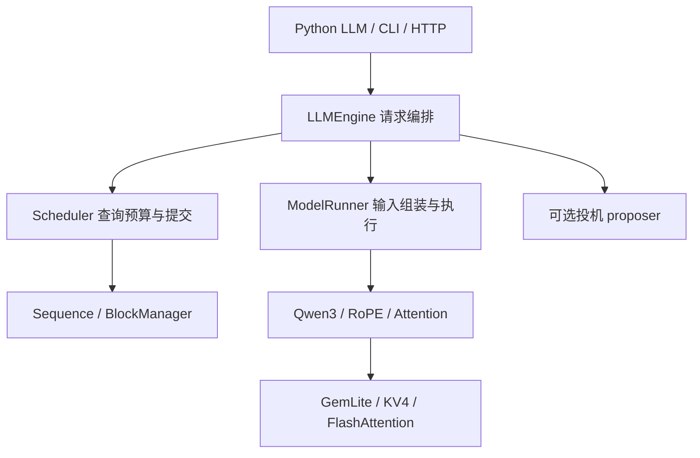

# Runtime 架构、加载与资源生命周期

Runtime 将完整模型目录转换成可持续处理请求的单 GPU 引擎。当前模型主体为项目内 Qwen3，实现不是通用任意 Hugging Face 架构执行器；Transformers 用于配置、tokenizer、离线参考及官方 DFlash 草稿加载。

## 1. 从用户入口到算子

| 组件 | 拥有的状态与职责 |
|---|---|
| `qslab.api.LLM` | 公开生成接口、tokenizer、统计和 close |
| `runtime/engine/llm_engine.py` | 请求进入、提议、执行、接受与结束的顺序 |
| `runtime/engine/scheduler.py` | 等待/运行队列、查询预算、抢占、提交和停止条件 |
| `runtime/state` | token 历史、有效 KV 长度、物理页引用和前缀索引 |
| `runtime/execute/model_runner.py` | 模型、KV 池、输入元数据、Graph 与 logits |
| `runtime/model` | Qwen3 网络结构、位置编码、Attention 与浮点加载 |

离线量化不导入这些执行对象；在线只读取产物。投机接受算法也不应直接修改请求，资源提交由调度器完成。

## 2. 初始化与加载顺序

`LLMEngine` 先构造 Config 和 tokenizer，读取草稿要求，再初始化目标 ModelRunner；目标 KV 容量确定后创建 Scheduler 和可选 proposer。

ModelRunner 的顺序为：构造模型并加载权重 → 可选 torch.compile → 预热估计峰值 → 分配 KV → 加载平滑参数 → 可选捕获 Graph。预热并不等于正式请求已运行。

浮点模型通过项目权重加载器加载；W4 模型检测 `quantization_config` 后用 Accelerate 创建 meta 参数，按显式量化层清单替换为 GemLiteLinear，再载入其余参数。共享 embedding/lm_head 在加载后绑定，避免先创建一份完整浮点模型。协议详见[量化包文档](../quantization/03-checkpoint.md)。

当前目标执行使用 FP16，W4 后端和 KV 类型分别配置。普通模型前向使用项目 Qwen3，不能把量化模型加载与 HF `generate()` 混为同一路径。

## 3. 配置如何决定容量

核心配置来自 [Config](../../qslab/runtime/config.py)。

| 参数 | 当前默认 | 作用 |
|---|---:|---|
| `max_model_len` | 4096 | 请求上下文上限，受模型位置范围限制 |
| `max_num_seqs` | 512 | 每步最多调度请求数 |
| `max_num_batched_tokens` | 16384 | 每步实际查询 token 预算 |
| `gpu_memory_utilization` | 0.9 | 模型与 KV 的显存预算比例 |
| `enforce_eager` | true | 默认不捕获 CUDA Graph |
| `kvcache_block_size` | 256 | 物理页包含的 token 数 |
| `num_kvcache_blocks` | -1 | 自动估计页数；可显式指定 |
| `kv_cache_dtype` | fp16 | 可选 kv4，须额外校准文件 |

这些是内部 Config / Python 的默认值；CLI 和 server 可覆盖默认值。`max_num_batched_tokens` 不是池容量，也不是一次请求总长度。自动 KV 分配还会考虑其他进程占用、模型预热峰值及静态表，最终容量要看实际分配日志。

草稿模型需要额外显存。默认 `draft_gpu_memory_reserve=0.15` 在总预算中为草稿预留整卡显存的 15 个百分点；它不是剩余显存的 15%，也不是目标与草稿各用一次完整预算。

## 4. 请求准入与停止

输入可为原始字符串或 token ID 列表。字符串直接编码，不自动代表已套聊天模板。输入必须非空且严格短于 `max_model_len`。

设 prompt 长度为 $L_p$，请求输出预算为 $B$，实际预算为：

$$
B'=\min(B,L_{\max}-L_p).
$$

引擎还检查单个请求按该预算是否能容纳于 KV 池；无法容纳时直接拒绝。预算超出剩余上下文会截断，不能靠不断抢占让单个超大请求最终成功。

完成条件为 EOS（除非 ignore_eos）、输出 token 上限或上下文上限。异常中止当前请求并重置执行上下文。批量提交输入时，如果其中一项准入失败，已排入的同次调用请求会撤销。

## 5. 释放的两种层级

请求完成、取消或被终止时，归还 KV 页的引用，并清理 proposer 的请求状态。零引用页可暂留内容用于前缀复用，因此“请求释放”不等于 CUDA 池张量已销毁。

`llm.close()` / 上下文管理器退出会关闭引擎和草稿，释放 Graph、KV、模型和临时特征引用，执行同步、垃圾回收及缓存清理。退出入口可重复调用；仍可能保留 CUDA 库工作区，不能仅凭 nvidia-smi 非零就断言模型泄漏。

使用方式与服务取消行为见[使用文档](03-usage-validation.md)，页引用与执行细节见[调度和执行](02-scheduling-execution.md)。Graph 捕获、重放与输出 buffer 的生命周期见 [CUDA Graph 设计](04-cuda-graph.md)。
