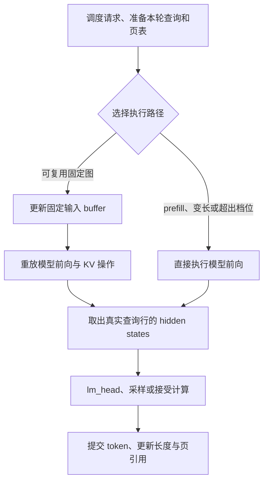

# CUDA Graph：让可变请求复用固定的执行过程

逐 token 推理反复执行相似的模型前向。一次前向包含许多 GPU 操作，主机要经过 Python、框架分派和 CUDA 调用将它们逐个提交。当单个操作很短时，这些提交及其间隙会占据明显时间。

CUDA Graph 将一段 GPU 工作及其依赖记录下来，后续通过重放提交。它主要减少重复的主机提交成本。模型的矩阵乘法、Attention、权重读取和 KV 访问仍然要执行；具体收益取决于原来的时间花在哪里。机制与使用约束见 [PyTorch CUDA Graph 说明](https://docs.pytorch.org/docs/2.7/notes/cuda.html#cuda-graphs)。

Runtime 需要解决的进一步问题是：每步的请求数、token、位置和缓存长度都在变化，怎样让这些变化落在一组固定图中，并保证填充计算不会破坏真实请求。

目标侧沿用 nano-vLLM 的固定输入容器、batch 档位和共享捕获池思路，并在项目中组织为 decode / verify 图族。接入来源见 [Runtime 上游说明](../../qslab/runtime/UPSTREAM.md)。

## 1. 先确定捕获哪一段

目标模型的 Graph 覆盖从输入 token 与位置到最后 hidden states 的模型前向，包括其中的权重计算、位置编码、KV 写入和 Attention。有 DFlash 特征输出时，还将这些特征复制到固定输出区。

调度、页分配、输入组装、目标模型的 lm_head、采样、投机接受与请求提交留在图外。

这个范围保留了模型内部重复提交最密集的一段，同时让请求控制继续使用实际工作量。例如，verify 的图可以计算固定数量的行，再只对有效行执行词表投影；不需要为填充行生成整张词表 logits。

图外操作也可能在 GPU 上运行。“图外”表示它们每轮单独提交，并不等于都在 CPU 上计算。具体边界可从 [`ModelRunner._forward`、`run` 与 `verify_logits`](../../qslab/runtime/execute/model_runner.py)对应到[模型前向及词表投影](../../qslab/runtime/model/qwen3.py)。

每一步仍要提交输入复制、控制 buffer 清理和图外计算。图重用的是模型内部的一段工作，GPU 内的各个节点也仍然执行；它减少了这一段反复经过主机分派的成本。

## 2. 固定地址，为什么还能处理新输入

普通调用可以把一个新 tensor 传给下一次 forward。重放则继续使用捕获时记录的地址：给 Python 变量重新绑定一个 tensor，不会自动改变图中已经记录的指针。

因此，当前实现为每种图族保留一组常驻 GPU buffer。本轮数据先复制进这些容器，再重放图，最后读取固定输出区。改变的是容器中的内容。

设最大捕获批次为 $B_{\max}$，每请求的固定查询行数为 $R$，hidden size 为 $H$。若物理页大小为 $P$，最大页表长度为 $C=\lceil\text{max\_model\_len}/P\rceil$：

| 固定区域 | 形状 | 每轮改变的内容 |
|---|---|---|
| token、位置、写入 slot | `[B_max × R]` | 当前输入、绝对位置及其物理写入地址 |
| 有效上下文长度 | `[B_max]` | 每个请求实际可读的历史范围 |
| 页表 | `[B_max,C]` | 每个请求逻辑页对应的物理页号 |
| 模型输出 | `[B_max × R,H]` | 本轮计算得到的 hidden states |
| 可选目标特征 | `[B_max × R,F]` | DFlash 所需层特征，$F$ 为拼接后的特征宽度 |

这些容器由 [`CUDAGraphs`](../../qslab/runtime/execute/cuda_graph.py)持有，存活时间覆盖图的使用期。不同 batch 档位只捕获相应大小的切片，同一图族可以共同使用最大尺寸的容器。

### 哪些变化能放进 buffer

token 内容、位置、长度、slot 和页表都是本轮数据，可以在地址不变的情况下更新。选择模型后端、KV 格式、图族和张量形状，则会影响外层执行结构，已经在准备与捕获时确定。

Attention 内核可以读取新的长度，在 GPU 内决定本次要遍历多少缓存、屏蔽哪些位置。因此，固定图可以处理增长中的上下文；它不要求所有请求的有效长度永远相同。

与此同时，Python 中读取 Context、选择分支和构造算子调用的过程，只在捕获 forward 时执行。重放不会重新跑一遍这段 Python。运行时更新新 Context 后，还必须把其中需要的数据复制到图已经绑定的 buffer。

## 3. 为什么分页 KV 适合这种执行方式

若每次上下文增长都换一张更大的 K/V tensor，图中记录的缓存地址就难以持续使用。当前 Runtime 先分配固定的物理 KV 池，再通过页表表达请求内容的位置。

图绑定的是池的基地址和页表 buffer；请求增长、结束或重新分配页面时，改变的是页表、写入 slot 和有效长度。下一轮便可以在同一物理池中访问另一组页面，而不需要因请求身份变化重新捕获模型。

这里同时有两层生命周期：KV 页的引用属于请求状态，Graph 与池张量属于 ModelRunner。一次请求归还页，并不会销毁捕获图或重新分配整个池。下一批请求可以继续使用图，但必须重新准备自己的地址和长度。

页映射及因果读取的计算见 [KV4 Attention](../kernels/02-kv4-attention.md)，页引用、抢占与提交见[调度文档](02-scheduling-execution.md)。Graph 复用依赖这些约定保持正确，并不替代它们。

## 4. 用两层固定形状覆盖可变工作量

### 4.1 每请求查询行数：decode 与 verify 分开

普通 decode 每请求只处理最后一个 token，使用 $R=1$ 的图族。投机验证则从最后一个已提交 token 开始，加上最多 $k$ 个候选，使用 $R=k+1$ 的图族。未启用投机时只需要前一族。

这不只是输入长度不同。多位置验证会改变 Attention 的查询组织，也会改变 Linear 展平后的行数，进而影响 W4 算子的分派与计算配置。因此，当前实现分别捕获两种形状，重放时直接选择对应图族。

例如 DFlash b16 对应目标侧 $R=16$。这些行中包含 anchor，即最后一个已提交 token，候选最多为 15 个。窗口来自草稿配置时，会在[构造目标执行器之前](../../qslab/runtime/speculation/factory.py)确定。

### 4.2 请求数：捕获若干 batch 档位

若为所有请求数分别捕获图，初始化和图对象数量会随上限增长；若只保留最大 batch，小批次又要承担大量填充计算。当前实现用一组离散档位折中。

捕获上限为 $\min(\text{max\_num\_seqs},512)$。档位包含上限范围内的 1、2、4、8，以及从 16 开始每隔 16 的大小，另加入上限本身。以最大 batch 为 32 为例，档位为 `[1,2,4,8,16,32]`。

真实批次有 $B$ 个请求时，选择最小的覆盖档位 $\widehat B\ge B$。例如 3 个请求重放 4 请求图，9 个请求重放 16 请求图。若配置上限本身为 3，则也会捕获 3 请求图。

图实际计算的查询行数为：

$$
Q_{\mathrm{graph}}=\widehat B\,R.
$$

档位减少了需要维护的执行形状，同时引入了 $\widehat B-B$ 个填充请求。档位越稀疏，图数量可能越少，但填充成本也可能越大。

### 4.3 逻辑查询预算与图内计算量要分开

设纯 decode / verify 批次有 3 个请求，固定窗口 $R=5$，实际查询行数分别为 5、3、1。调度器安排了 9 个有效查询；若选择 4 请求图，模型内部仍会计算 $4\times5=20$ 行。

两种填充同时存在：真实请求内部的候选不足，以及 batch 档位多出的请求。它们决定实际 GPU 工作量，但不应该被当作已生成 token 或已提交查询来计数。

`verify_logits` 按每个请求真实的 `num_scheduled_tokens` 取出有效 hidden states，再执行 lm_head。提议数量减少时，逻辑工作量会下降，固定窗口的模型计算却不一定同比下降。

## 5. 每次重放之前，为什么要清理控制信息

重放过程可以概括为：选择图族，更新真实输入，重置填充控制信息，复制本轮元数据，选择覆盖档位，再执行图。

实现会将整份 `slot_mapping` 先填成 -1，再写入真实行；将上下文长度清零，再写入真实请求；将页表区域清零，再覆盖本轮页表。这样，上一轮较大批次留下的地址与长度不会继续被当成下一轮的有效状态。

填充 token 和位置本身不必每次全部清零。它们仍可能参与模型计算，隔离依赖的是明确的控制约定：

| 情况 | 写入怎样处理 | 输出怎样处理 |
|---|---|---|
| 档位多出的填充请求 | slot=-1，KV 写入跳过 | 重放后只返回真实 $B$ 个请求对应的区域 |
| 真实请求中不足窗口的候选行 | 无效行的 slot=-1 | verify 只选择实际调度行的 logits |
| 实际缓存范围以外的位置 | 由页表、有效长度和因果 mask 共同限制访问 | 无效计算不进入请求提交 |

因此，正确性不依赖“填充输入一定为零”或“填充行输出一定为零”。重点是保护真实缓存写入，并保证这些额外结果不会进入采样、接受和提交。

对于真实的验证行，所有候选 K/V 可以先写入，但较早查询仍然只能读取自己的因果前缀。固定形状带来的填充，与 Attention 的因果 mask 是两层不同的约束。地址安全与数值检查见 [Kernel 验证](../kernels/03-validation.md)。

## 6. 哪些情况选择图外 forward

当前 [`run_model` 与 `verify_logits`](../../qslab/runtime/execute/model_runner.py)保留几种直接执行路径：

| 情况 | 当前选择 | 设计上的原因 |
|---|---|---|
| `enforce_eager=True` | 直接 forward | 显式选择普通执行方式 |
| prefill，包括有 prefill 的混合批次 | 实际长度 varlen forward | 查询长度、前缀与拼接结构变化较多 |
| 实际请求数超过最大捕获档位 | 直接 forward | 没有能覆盖这个形状的图 |
| 验证的名义窗口延伸出上下文上限 | 实际长度 varlen forward | 避免为了固定窗口构造越过有效位置范围的输入 |

prefill 从几十行到几千行不等，混合批次还会组合不同请求和前缀。若全部纳入图，需要继续设计长度与组合档位，并付出捕获、填充及常驻空间。当前实现将图集中用于反复出现的小查询前向，prefill 使用实际形状。

分块 prefill 因而可以与 Graph 共存：纯 decode / verify 步仍可重放图，含 prefill 的步使用 varlen。开启分块调度不会让每一步都进入同一张固定图。

上下文末端也需要单独判断。例如只剩两个可计算位置时，固定五行窗口即使丢弃多余输出，构造位置和缓存访问仍可能越过边界。这里直接按真实查询长度执行，比依赖计算结束后丢弃结果更明确。

## 7. 捕获怎样融入初始化

图需要绑定已经准备好的权重、缓存和执行路径。目标侧顺序是：加载模型与 W4 布局，进行模型预热，分配 KV 池并加载平滑参数，最后捕获 Graph。

随后，对每个图族与 batch 档位先执行一次未捕获的 forward，再在 `torch.cuda.graph` 内记录 forward 与固定输出复制。这样，具体形状首次需要的编译、调优和工作区准备可以发生在记录之前。捕获流上下文由 PyTorch 的包装管理。

这时使用占位 token 和控制信息，slot=-1 等约定保护缓存写入，准备过程不提交真实请求。捕获产生的 hidden states 只是准备结果；以后每次重放仍会根据新输入执行整段计算。

各档位按从大到小的顺序捕获。首张图取得的 pool 作为后续捕获的共享池提示，让不同档位尝试复用工作区，减少每张图独立保留一套临时空间的成本。较大形状先进入池，有利于后续较小形状复用已准备的空间；实际占用仍受具体算子路径影响。

图对象、输入输出容器和捕获池一起由执行器持有。当前 Runner 每步选择一张图执行，batch 提供请求间的并行，同一套输入与输出容器则按串行步骤更新和消费。多图池复用涉及重放依赖与张量生存期，其约束见 [PyTorch 的图内存管理说明](https://docs.pytorch.org/docs/2.7/notes/cuda.html#graph-memory-management)。

### 与 torch.compile 的分工

`torch.compile` 可以改变算子组织与融合，CUDA Graph 则重用已经形成的 GPU 工作提交过程。当前执行器在配置 compile 时，先编译和预热，再捕获相应前向。两种机制可以组合，但分析结果时需要分清各自开启状态。

模型加载与初始化入口见 [`ModelRunner._initialize_execution`](../../qslab/runtime/execute/model_runner.py)，图族、档位与捕获过程见 [`CUDAGraphs.capture`](../../qslab/runtime/execute/cuda_graph.py)。

## 8. 图的输出为什么不能直接当长期状态

重放返回的是固定输出 buffer 中的一段视图。下一次使用同一图族时，这些位置会被新结果覆盖。返回一个 tensor 引用，不等于为本轮结果保存了独立副本。

普通生成会在下一步前完成 lm_head、采样和提交。DFlash 还需要保留多轮目标特征，因此捕获时先将特征写到固定 features 区，随后 [`DFlashProposer.observe`](../../qslab/runtime/speculation/dflash.py)把真正保留的特征复制到请求自己的状态中。

这也解释了图对象与请求状态的分工：图拥有可以反复覆盖的计算容器，请求拥有需要跨轮保留的内容。取消请求时应释放后者；关闭 Runner 时再释放模型、Graph 和 KV 池引用。捕获池与仍被引用的捕获张量会影响显存何时真正归还。

### 节省提交时间，需要多少额外空间

固定容器会随最大 batch、验证窗口、hidden size、页表宽度和特征宽度增长。多个图族各自保存容器，图内临时分配和 CUDA 库工作区又会占据另外的空间。

重放时对 slot、长度和页表的重置也覆盖整份容器。因此，最大配置影响的不仅是显存，还包括小批次每步更新控制信息的成本。

共享捕获池能减少重复保留，但不会消除这些成本。当前 KV 容量估计发生在捕获之前，因此 KV 页的预算也不能单独代表包含 Graph 后的完整峰值。应结合[整模显存测量](../../benchmarks/runtime/memory/README.md)观察加载、捕获和生成的全过程。

## 9. 目标、普通草稿和 DFlash 草稿的图有什么区别

前文描述的是目标侧 `CUDAGraphs`。项目中还有另外两种使用场景：

| 使用者 | 计算组织 | 捕获范围与状态 |
|---|---|---|
| 目标模型 | 单行 decode 与固定窗口 verify | 模型前向、KV 操作及可选特征输出，目标 lm_head 留在图外 |
| 普通自回归草稿 | 主要使用自己的 $R=1$ 图 | 独立 ModelRunner 与分页池，逐步提议候选 |
| DFlash 草稿 | 官方 block forward 与 StaticCache | 专用图包含草稿前向、目标词表投影和 argmax，输出候选 token |

普通草稿使用与目标相同的 ModelRunner 机制，但状态、权重和缓存独立。少量待补算 token 可以分几次单行重放处理；较长补算仍使用实际长度路径，见[草稿执行](../../qslab/runtime/speculation/draft.py)。

DFlash 的官方 forward、BF16 草稿状态和缓存写入方式不同，由 [`DFlashGraphRunner`](../../qslab/runtime/speculation/dflash_graph.py)单独适配。它用固定容量 StaticCache 保持地址，通过长度、位置与 mask 表示有效内容；若新增目标特征超过一个固定 block，则先走实际长度的 forward，稳定的小块步骤再使用图。

其缓存槽在需要时建立并捕获，结束后放回复用列表。槽内旧数据的可见性由新请求的写入、长度和 mask 控制。这与目标按 batch 档位保存图的方式不同，阅读性能结果时也要区分目标 Graph 与草稿 Graph 的开关。DFlash 专用图还要求目标 Graph 开关开启，并允许通过 `dflash_graph` 单独控制。

## 10. 怎样判断图是否值得使用

首先需要确认真正发生了 replay。目标执行器分别记录 decode 与 verify 的重放次数，以及变长验证次数；配置开启 Graph，并不意味着所有请求步骤都进入了图。

然后比较相同权重、KV、输入输出规模和调度设置下的请求延迟。当前 [CUDA Graph 对照](../../benchmarks/runtime/cuda_graph/RESULTS.md)主要展示 TPOT 的改善，prefill 的 TTFT 还取决于图外工作。模型初始化与捕获成本另行观察，不能把稳态重放延迟当作冷启动成本。

还需要区分几种变化：

- 图减少的是重复提交及间隙，单个 kernel 的计算公式没有因此简化。
- 档位与固定窗口可能增加实际计算行数；与 eager 直接使用真实行数相比，算子分派和归约配置也可能不同。
- 填充写入保护、有效输出选择和跨轮状态拷贝，决定快路径是否保持请求语义。
- 更大的捕获范围与更多图形状，需要额外初始化和显存，应与延迟一起评估。

页表宽度也是一个具体例子：Graph 使用按最大上下文准备的固定页表，而 eager 可以使用本轮实际页数对应的宽度。当前 KV4 的分片启发式参考页表容量，因此两条路径可能选择不同 split 数，产生不同的空分片成本和浮点归约顺序。它们应保持相同的有效读取范围，数值对照则按允许误差判断，详见 [Attention 设计](../kernels/02-kv4-attention.md)。

验证入口可分别看[真实模型执行与切桶测试](../../tests/runtime/test_execution.py)、[目标特征的 decode / verify 重放测试](../../tests/speculation/test_features.py)、[上下文末端验证测试](../../tests/speculation/test_ngram_execution.py)以及 [DFlash 缓存和图槽复用测试](../../tests/speculation/test_dflash.py)。这些检查关注数值、缓存和状态；性能由 [benchmark](../../benchmarks/runtime/cuda_graph/README.md)与 [Nsight](../../benchmarks/runtime/profile/README.md)说明。

启用目标 Graph 使用 `enforce_eager=False`，CLI 对应 `--cuda-graph`；完整调用方式见[使用文档](03-usage-validation.md)。
