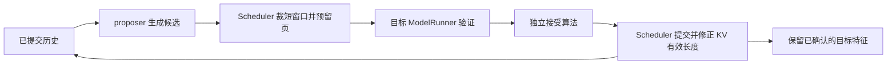

# 自回归草稿、DFlash 与状态同步

## 1. 引擎中的一轮顺序



LLMEngine 编排，proposer 不决定目标接受，ModelRunner 不执行接受算法。先按预算限制付费草稿生成，再调度目标验证，避免明知会被裁掉仍生成大量候选。

纯 verify 可用固定 $M=k+1$ 目标 Graph，普通 decode 用 $M=1$；混合 prefill/verify 或上下文边界使用实际长度路径。填充行不写有效 KV。完整页状态见[Runtime 执行文档](../runtime/02-scheduling-execution.md)。

## 2. 自回归草稿复用 Runtime

[DraftProposer](../../qslab/runtime/speculation/draft.py)创建自己的 ModelRunner、BlockManager 和 Sequence，复用 Qwen3、分页 KV 与 decode Graph，但没有再套一个独立 Scheduler。

目标和草稿必须使用相同 token IDs、特殊 token 和相容词表，草稿上下文要覆盖目标配置。两侧权重与 KV 可以分别采用浮点或量化；草稿使用自身的 `draft_smooth_kv`。

每轮同步以目标已提交历史为准，只复用相同且确实计算过 KV 的共同前缀。拒绝后截掉草稿分支，后续重新补算。全部接受也不等于无需同步：最后生成的草稿 token 和目标 bonus 可能尚未在草稿侧计算 KV。

补算受查询预算限制，未补完时返回空候选，让目标正常推进。短补算可借用 M=1 Graph，不能把所有补算成本忽略。草稿分支关闭前缀发布，防止未确认内容被其他请求复用。

```python
from qslab.api import LLM, SamplingParams

with LLM(
    "models/Qwen3-8B-W4-rtn",
    spec="draft", draft="models/Qwen3-1.7B-W4-rtn", spec_gamma=4,
    kv_cache_dtype="kv4", smooth_kv="datasets/kv4/qwen3-8b.pt",
    draft_kv_cache_dtype="kv4", draft_smooth_kv="datasets/kv4/qwen3-1.7b.pt",
    enforce_eager=False, enable_chunked_prefill=True,
    max_num_seqs=1, max_model_len=1024, max_num_batched_tokens=64,
) as llm:
    print(llm.generate("The capital of France is", SamplingParams(max_tokens=32)))
```

## 3. DFlash 接入的是哪部分

[DFlashProposer](../../qslab/runtime/speculation/dflash.py)通过 checkpoint 的 `auto_map` 加载官方模型 forward，使用 BF16 草稿权重与缓存；目标 embedding、lm_head 和指定层隐藏特征由本项目提供。不是把整套目标调度交给外部框架。

factory 先检查目标/草稿 hidden size、目标层数和词表大小匹配。候选窗口从 checkpoint 的 `block_size` 确定；b16 代表 15 个候选与 16 行目标验证，不能用 `spec_gamma` 把它任意改为另一个训练块长。

草稿输入包括最后一个已提交 anchor token、mask 占位和新增目标特征；块内草稿 forward 可非因果，但目标验证始终因果。草稿临时噪声块不会作为已确认历史长期保留。

## 4. DFlash 特征为什么不能直接复用目标 KV

目标特征只记录已确认且已计算的连续前缀。若已提交长度为 $L$，提议前应满足：

$$
L_{\mathrm{features}}=L-1.
$$

最后的 anchor 已有 token ID，但其隐藏特征将在后续目标执行中产生。Graph 输出 buffer 会被下一轮覆盖，因此 observe 必须复制要保留的特征，不能只持有临时视图。

目标 KV 的普通前缀缓存没有对应 DFlash 隐藏特征，引擎因此在 DFlash 模式关闭目标前缀复用。请求结束、取消、异常或抢占时清理草稿请求状态，不能把旧特征接到不同前缀上。

[DFlashGraphRunner](../../qslab/runtime/speculation/dflash_graph.py)拥有独立 StaticCache 槽位与草稿 Graph。首次长前缀走 eager，后续符合固定形状时重放；槽位释放后可复用。目标与草稿 Graph 是两套不同执行资源。

## 5. DFlash 最小使用方式

```python
from qslab.api import LLM, SamplingParams

with LLM(
    "models/Qwen3-8B-W4-rtn",
    kv_cache_dtype="kv4", smooth_kv="datasets/kv4/qwen3-8b.pt",
    spec="dflash", draft="models/Qwen3-8B-DFlash-b16",
    enforce_eager=False, enable_chunked_prefill=True,
    max_num_seqs=1, max_model_len=1024, max_num_batched_tokens=64,
) as llm:
    prompt = llm.tokenizer.apply_chat_template(
        [{"role": "user", "content": "Explain binary search briefly."}],
        tokenize=True, add_generation_prompt=True, enable_thinking=False,
    )
    result = llm.generate(prompt, SamplingParams(max_tokens=128))
    print(result["text"], result["stats"])
```

当前范围是 greedy、非 thinking。`enforce_eager=False` 允许目标和草稿 Graph；`dflash_graph=False` 仅关闭 DFlash 草稿 Graph。草稿不使用 `draft_kv_cache_dtype="kv4"` 这条自回归草稿配置，不能将两种 proposer 的缓存实现混用。

ngram 的最小开关为 `spec="ngram", spec_gamma=2`；lookahead 使用 `spec="lookahead"`，当前不支持混合 chunked prefill 配置。CLI 对应 `--spec`、`--draft`、`--spec-gamma`；完整 HTTP 与模板约定见[执行入口说明](../../qslab/runtime/speculation/README.md)。
